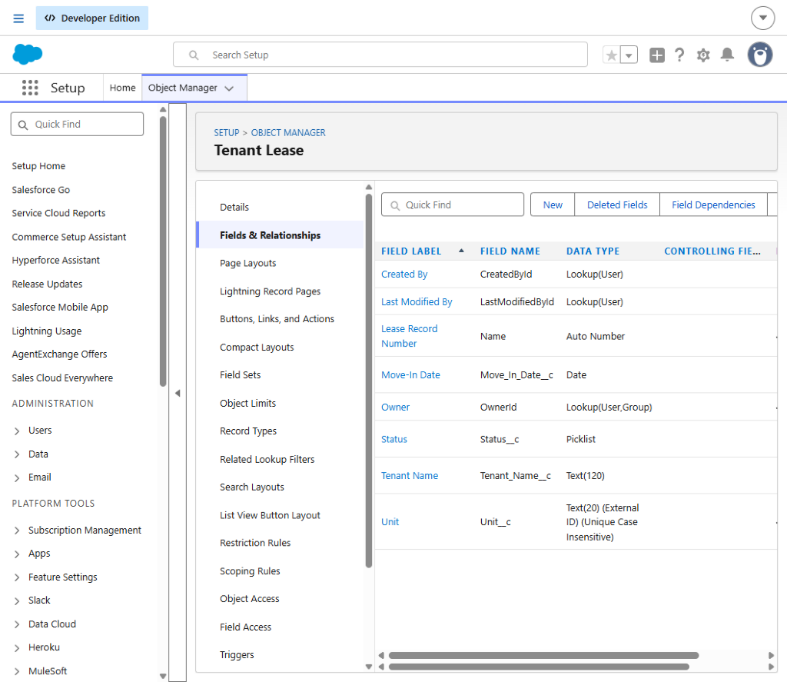
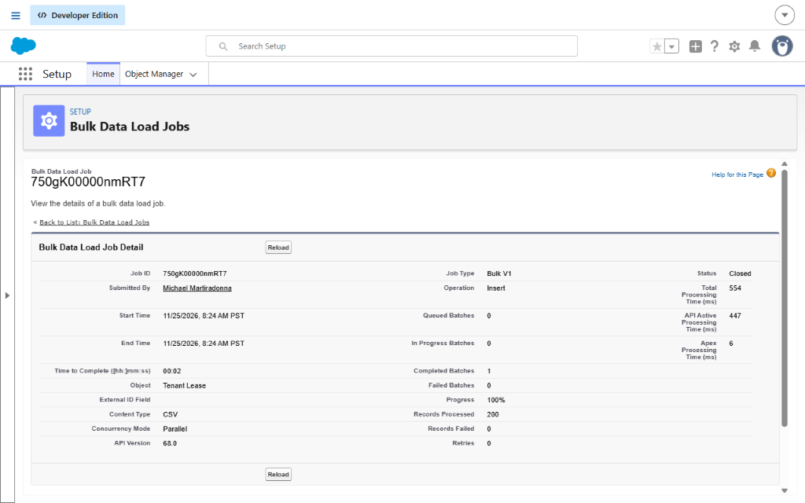
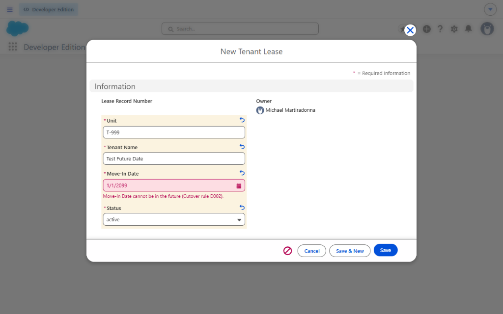
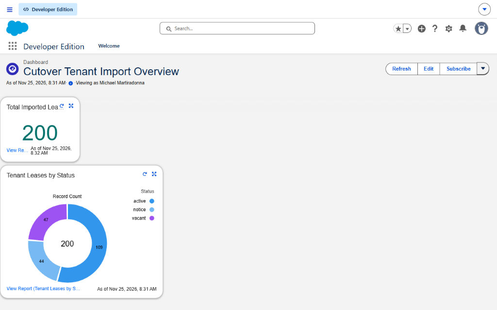

# Salesforce Destination Example (Custom Object, Validation Rule & Data Import Wizard)

This folder documents how Cutover's reviewed, synthetic AppFolio-style tenant file (`data/examples/tenants_appfolio_200_reviewed.csv`, 200 rows) lands in **Salesforce** as a CRM destination — enforcing the same data-quality rules at the destination layer that Cutover enforces before handoff.

## 1. Custom Object Schema (`Tenant_Lease__c`)

Standard Salesforce Metadata API definitions live under [metadata/objects/Tenant_Lease__c/](metadata/objects/Tenant_Lease__c/). The object enables reporting (`enableReports: true`) and field history tracking (`enableHistory: true`).

| Field API Name | Label | Type | Constraints | Cutover Rule Mirrored |
|---|---|---|---|---|
| `Name` | Lease Record Number | Auto Number (`TL-{0000}`) | System-generated primary key | — |
| `Unit__c` | Unit | Text (20) | Required, **Unique (case-insensitive)**, **External ID** | `R001` (required), `U001` (unique) |
| `Tenant_Name__c` | Tenant Name | Text (120) | Required | `R001` (required) |
| `Move_In_Date__c` | Move-In Date | Date | Required | `R001`, `D001` (valid date) |
| `Status__c` | Status | Picklist | Required, **Restricted** (`active`, `notice`, `vacant`) | `E001` (allowed enum values) |

## 2. Destination Validation Rule (`No_Future_Move_In_Date`)

Defined in [No_Future_Move_In_Date.validationRule-meta.xml](metadata/objects/Tenant_Lease__c/validationRules/No_Future_Move_In_Date.validationRule-meta.xml):

- **Error Condition Formula:** `Move_In_Date__c > TODAY()`
- **Error Location:** `Move_In_Date__c`
- **Error Message:** `Move-In Date cannot be in the future (Cutover rule D002).`

**Why enforce it in both places:** Cutover catches bad rows before the file leaves the staging pipeline; keeping matching restricted picklists, a unique External ID, and `No_Future_Move_In_Date` inside Salesforce ensures manual edits or ad-hoc imports after go-live cannot reintroduce invalid records.

## 3. Importing the Reviewed CSV (Data Import Wizard)

Import **only** the validated file (`data/examples/tenants_appfolio_200_reviewed.csv` — never the raw file with 12 deliberate faults):

1. Open **Setup → Data Import Wizard → Launch Wizard**.
2. Choose **Custom objects → Tenant Leases → Add new records** (or **Add new and update existing records** matching on `Unit (External ID)`).
3. Upload `data/examples/tenants_appfolio_200_reviewed.csv` and map columns:

| CSV Header | Salesforce Field |
|---|---|
| `unit` | `Unit` (`Unit__c`) |
| `name` | `Tenant Name` (`Tenant_Name__c`) |
| `move_in_date` | `Move-In Date` (`Move_In_Date__c`) |
| `status` | `Status` (`Status__c`) |

4. Start the import and verify **Bulk Data Load Jobs** reports `200` records processed and `0` records failed.
5. **Negative verification:** Manually create a test record with `Move-In Date = 2099-01-01` and confirm Salesforce blocks saving with `Move-In Date cannot be in the future (Cutover rule D002).`

## 4. Post-Import Reconciliation Report & Dashboard

Create a Salesforce Summary Report (`Tenant Leases by Status`, grouped by `Status`) and attach a Dashboard (`Cutover Tenant Import Overview`) with a KPI Metric (`Total Records`) and Donut/Bar Chart (`Records by Status`).

Compare the live Salesforce Report totals directly against the reviewed CSV baseline:

| Status | Expected Count | Share |
|---|---:|---:|
| `active` | 109 | 54.5% |
| `vacant` | 47 | 23.5% |
| `notice` | 44 | 22.0% |
| **Total** | **200** | **100.0%** |

Additional source checks for spot-auditing:
- **Unique units:** `200` (Building `A`: `70`, Building `B`: `70`, Building `C`: `60`)
- **Move-in date span:** `2015-01-06` through `2026-06-28` (`0` future dates)

## 5. Verified Salesforce Developer Edition Run (2026-11-25)

All four stages were executed in a Salesforce Developer Edition org:

- **Custom Object & Fields (`Tenant_Lease__c`):** Auto Number `TL-{0000}`, `Unit__c` (Unique Case-Insensitive External ID), `Tenant_Name__c`, `Move_In_Date__c`, and restricted picklist `Status__c` (`active`, `notice`, `vacant`).
  
- **Data Import Wizard:** Uploaded `tenants_appfolio_200_reviewed.csv` with workflows and validation rules enabled — Bulk Data Load Job completed at `100%` with **200 records processed, 0 failed**.
  
- **Validation Rule Enforcement (`No_Future_Move_In_Date`):** Attempted saving a record with `Move-In Date = 1/1/2099`; Salesforce blocked saving with `Move-In Date cannot be in the future (Cutover rule D002).`.
  
- **Post-Import Reconciliation (`Tenant Leases by Status` Report + `Cutover Tenant Import Overview` Dashboard):** Confirmed exact parity with the CSV baseline — **109 active**, **47 vacant**, **44 notice**, **200 total**.
  
